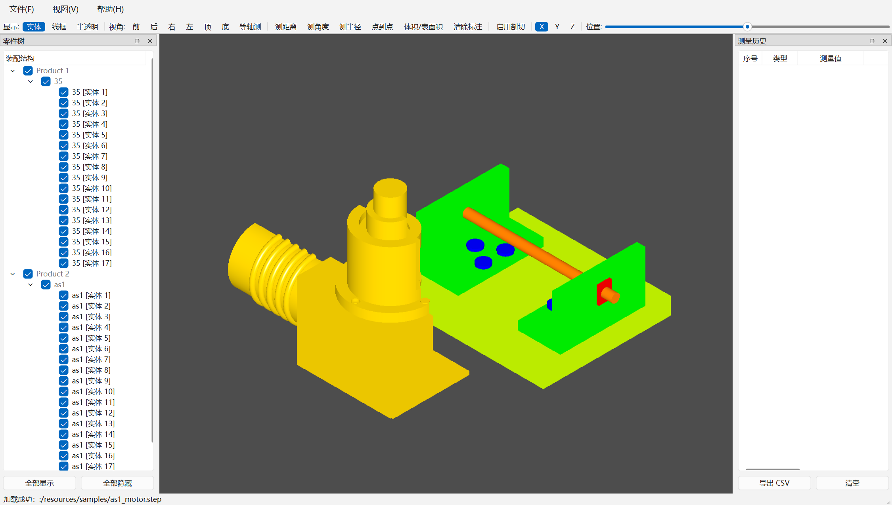

# OCCT Viewer

基于 **Qt 6 + OpenCASCADE** 的 3D CAD 装配体查看器，用于浏览、检查与测量 STEP（AP203/AP214）装配体。

使用 XCAF 完整读取装配结构、颜色与名称，提供零件树、几何测量、3D 标注、测量历史导出与实时剖切。



> 上图为程序实际运行的截图（内嵌的 `as1_motor.step` 示例模型，39 个零件）。程序通过 `--screenshot` 从 OCCT 的帧缓冲中直接取 3D 图像，再与 Qt 界面合成 —— 不受驱动/DPI/远程桌面影响。

---

## 功能特性

### 装配体读取（XCAF）
- 通过 `STEPCAFControl_Reader` 读取 STEP 文件，保留**装配层级、零件名称、颜色、材质**
- 自动单位识别与缩放（如模型以 mm 存储而场景为 m 时自动 `0.001` 换算）
- 支持从 **qrc 内嵌资源** 直接加载（无需外部文件）
- 启动时自动加载内嵌的 `as1_motor.step`，开箱即用

### 零件树面板
- 左侧 `QTreeWidget` 按装配层级展示零件，点击可在视图中高亮定位
- 一键「全部显示 / 全部隐藏」，便于逐层拆解检查

### 几何测量
| 模式 | 说明 |
| --- | --- |
| 距离 | 两个面之间的最短距离 |
| 角度 | 两个面法向的夹角 |
| 半径 | 圆柱/圆面的半径 |
| 点到点 | 两个顶点的直线距离 |
| 体积/表面积 | 选中实体的体积与表面积 |

- 测量结果实时显示在状态栏，并同步写入「测量历史」表格
- 支持 **3D 标注**（尺寸线 + 数值标签），可单独清除标注

### 测量历史
- 右侧表格记录类型 / 数值 / 详情 / 时间
- **一键导出 CSV**（UTF-8 带 BOM，Excel 直接打开不乱码）

### 剖切（Clipping）
- X / Y / Z 三轴剖切平面，滑杆实时调整位置
- 剖切平面随模型包围盒自动初始化

### 显示与视图
- 显示模式：**实体着色 / 线框 / 半透明**（对 XCAF 装配体整体生效）
- 7 个标准视角：前、后、右、左、顶、底、等轴测（快捷键 `1`–`6`、`0`）
- 适应窗口 `F`、视图立方体、快速几何体（立方体/圆柱）演示

---

## 技术栈

- **C++17**
- **Qt 6.11.2**（Widgets / OpenGLWidgets）
- **OpenCASCADE 7.8.0**（XCAF、TKV3d、TKOpenGl、TKDE、TKXCAF、TKVCAF…）
- **CMake 3.16+** / MSVC 2022 (v143)
- **Qt Test** 单元测试

## 目录结构

```
untitled2/
├── src/
│   ├── main.cpp            # 程序入口（QApplication + MainWindow）
│   ├── Types.h             # 共享数据结构：MeasureRecord / PartInfo / MeasureMode
│   ├── OcctViewport.h/.cpp # 3D 视图：XCAF 加载、显示模式、测量、剖切、标注、截图
│   ├── MainWindow.h/.cpp   # 主窗口：菜单、工具栏、零件树、测量历史、文件打开
├── resources/
│   ├── app.ico             # 应用图标（多尺寸 16–256）
│   └── samples/
│       └── as1_motor.step  # 内嵌示例装配体（AP214，39 零件）
├── resources.qrc           # qrc 资源清单（与 CMake 中 qt_add_resources 等价）
├── tests/
│   └── tst_measure.cpp     # Qt Test：BRepExtrema_DistShapeShape 距离/包围盒测试
├── screenshots/
│   ├── main.png            # 主界面截图
│   └── app_icon.png        # 应用图标预览
├── deploy.ps1              # 一键打包脚本（build + windeployqt + 复制 OCCT DLL）
├── CMakeLists.txt
└── README.md
```

---

## 环境要求

| 依赖 | 版本 | 说明 |
| --- | --- | --- |
| Qt | 6.11.2 MSVC2022 64bit | `F:/Qt/6.11.2/msvc2022_64` |
| OpenCASCADE | 7.8.0 (vc143-64) | `C:/OpenCASCADE-7.8.0/occt-vc143-64` |
| OCCT 3rdparty | vc14-64 | `C:/OpenCASCADE-7.8.0/3rdparty-vc14-64` |
| Visual Studio | 2022 (MSVC 19.4x, v143) | x64 工具集 |
| CMake | 3.16+ | 例如 `F:/Qt/Tools/CMake_64/bin/cmake.exe` |

> OCCT 路径可通过 CMake 缓存变量覆盖：`-DOCCT_ROOT=... -DOCCT_3RDPARTY=...`，或设置环境变量 `OpenCASCADE_DIR`。

## 构建

```bash
cmake -S . -B build-msvc -G "Visual Studio 17 2022" -A x64 \
      -DCMAKE_PREFIX_PATH="F:/Qt/6.11.2/msvc2022_64"
cmake --build build-msvc --config Release
```

产物：`build-msvc/Release/untitled2.exe`（构建后自动把 OCCT / 3rdparty DLL 复制到同目录）。

也可以直接用 Qt Creator 打开 `CMakeLists.txt` 构建。

### 构建选项

| 选项 | 默认 | 说明 |
| --- | --- | --- |
| `UNTITLED2_BUILD_TESTS` | `ON` | 构建 `tst_measure` 单元测试（Qt6::Test 缺失时自动跳过） |

## 运行

- **已打包版本**：双击 `dist/untitled2.exe`，无需安装 Qt / OCCT，无需 Qt Creator
- **直接运行构建产物**：把 `F:/Qt/6.11.2/msvc2022_64/bin` 加入 `PATH` 后运行 `build-msvc/Release/untitled2.exe`

### 命令行选项

| 参数 | 说明 |
| --- | --- |
| `--view <0..6>` | 启动后切换到指定标准视角（0 前 / 1 后 / 2 右 / 3 左 / 4 顶 / 5 底 / 6 等轴测） |
| `--screenshot <file.png>` | 启动后 1.5 s 截图并退出（CI / 文档配图用） |
| `--smoke` | 冒烟测试：3 s 后退出，模型加载成功返回 `0`，失败返回 `1` |
| `--selftest-measure` | 测量自检：在视口内自动扫描并模拟拾取，验证 5 种测量模式，全部通过返回 `0` |

示例（CI 里验证构建可用）：

```bash
untitled2.exe --screenshot out.png --smoke
echo $?   # 0 = 内嵌 STEP 加载成功
```

示例（自动化验证测量模块，日志走 stderr）：

```bash
untitled2.exe --selftest-measure
echo $?   # 0 = 5/5 项测量全部通过
```

内嵌 `as1_motor.step` 的实测输出（Release，打包版 exe，无 Qt 环境的 PATH）：

```
[AUTOLOAD] 尝试加载： ":/resources/samples/as1_motor.step"
[UNIT] 单实体尺寸 209000 ，已缩放 0.001
XCAF 加载成功，零件数： 39
[SELFTEST-OK] 距离 -> 距离 = 38.048 mm (面到面)
[SELFTEST-OK] 角度 -> 角度 = 90.000° (法向量夹角 90.00°)
[SELFTEST-OK] 点到点 -> 点到点 = 64.925 mm (顶点到顶点)
[SELFTEST-OK] 体积/表面积 -> 体积 = 133583.265 mm3 (表面积 21726.112 mm2)
[SELFTEST-OK] 半径 -> 半径 = 32.000 mm (圆柱，直径 64.000 mm)
[SELFTEST] 通过 5/5 项测量
```

> 自检不是「另写一套算法」，而是直接调用鼠标点击时走的同一条路径：`AIS_InteractiveContext::MoveTo()` 求交拾取 → `doMeasurePick()` → `handleDistance/handleAngle/...`，因此能覆盖真实的交互链路。

## 鼠标操作

| 操作 | 效果 |
| --- | --- |
| 左键拖动 | 旋转模型 |
| 右键拖动 | 平移模型 |
| 滚轮 | 缩放 |
| 测量模式下左键单击 | 拾取面/点/实体（右键拖动仍可旋转） |
| `Esc` | 退出测量 / 清除当前测量 |

---

## 打包（windeployqt）

```powershell
powershell -ExecutionPolicy Bypass -File deploy.ps1
```

脚本会依次：配置 + 编译 Release → 复制 exe 到 `dist/` → 运行 `windeployqt` → 复制 OCCT 与第三方 DLL（含 `FreeImage.dll`、`gl2ps.dll`、TBB、FreeType、jemalloc、FFmpeg、OpenVR、MSVC CRT）。

打包完成后直接双击 `dist/untitled2.exe` 即可运行（可在无 Qt 环境的机器上验证：把 `PATH` 清空后启动）。

---

## 测试

```bash
cmake --build build-msvc --config Release
ctest --test-dir build-msvc -C Release --output-on-failure
```

`tst_measure` 覆盖：

1. 两个 100 mm 立方体相距 200 mm（中心距）→ `BRepExtrema_DistShapeShape` 距离为 **100 mm**
2. 两个贴合立方体 → 距离为 **0**
3. `Bnd_Box` 边界与几何构造一致

除单元测试外，程序内置**端到端自检**：`untitled2.exe --selftest-measure` 会在真实视口里自动扫描像素、模拟拾取，跑完 5 种测量模式并按通过数返回退出码（见上文「命令行选项」）。单元测试 + 自检 + `--smoke` 三者组合即可在无人值守的 CI 里验证「能加载、能渲染、能测量」。

---

## 实现要点 / 踩过的坑

- **XCAF 零件不会自动继承显示模式**：`AIS_InteractiveContext::Display()` 后零件保持 `AIS_Shape` 默认模式，导致装配体看起来像线框。加载完成后必须对每个 `AIS_Shape` 显式 `SetDisplayMode(AIS_Shaded)` 并 `Redraw()`。
- **Qt 原生 OpenGL 子窗口无法用 `QWidget::grab()` 抓取**：`grab()` 只能拿到 Qt 绘制的部分，3D 区域是空的。截图需用 `V3d_View::Dump()`（OCCT 7.8 的签名是 `Dump(const Standard_CString, const Graphic3d_BufferType&)`，**没有** `DumpToImage`）导出 3D 图，再按设备像素合成到 `grab()` 结果上。
- **高 DPI 下合成会偏移**：`grab()` 返回的 `QImage` 自带 `devicePixelRatio`（150% 缩放下为 1.5），若再按 DPR 缩放会二次放大。做法是先 `setDevicePixelRatio(1.0)`，再用 `几何 × dpr` 计算设备像素矩形。
- **`moc` 与无 `Q_OBJECT` 类**：窗口与视图类均不使用信号槽（改用 `std::function` 回调），因此不需要 `Q_OBJECT`，也避免了 moc 对头文件包含顺序的额外要求。
- **UTF-8 无 BOM 源码**：中文注释在 MSVC 下需显式 `/utf-8`，否则按 GBK 解析会报 C2001/C4819。
- **`resources.qrc` 与 `qt_add_resources` 不能同时参与构建**，否则资源重复注册；本项目用 `qt_add_resources`，`resources.qrc` 仅作为等价清单保留。

## 许可证

示例模型 `as1_motor.step` 来自 OpenCASCADE 官方数据集，遵循其原始许可；其余代码可自由用于学习与展示。